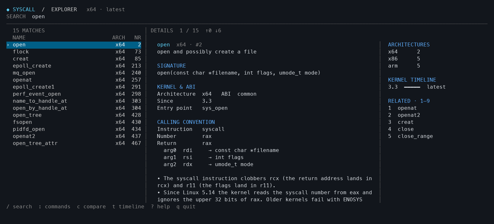

# syscall

[](https://github.com/guitmz/syscall/actions/workflows/ci.yml)
[](https://buymeacoffee.com/guitmz)

Explore Linux system calls from your terminal. Look up numbers and signatures, compare architectures, browse kernel history or search everything in an interactive explorer. Data comes from [api.syscall.sh](https://api.syscall.sh) and ships inside the binary, so it all works offline. You can also browse at [syscall.sh](https://syscall.sh).



## Install

```sh
brew install guitmz/tools/syscall           # with Homebrew
go install github.com/guitmz/syscall@latest # Go 1.27 or newer
# or grab a Linux or macOS archive from the releases page
```

## Get started

```sh
syscall memfd_create
```

```
memfd_create - create an anonymous file
memfd_create(const char *uname_ptr, unsigned int flags)
needs CONFIG_MEMFD_CREATE, returns ENOSYS without it

ARCH     NR   HEX    INSN      NR REG  ARG0  ARG1  RET
x64      319  0x13f  syscall   rax     rdi   rsi   rax
x86      356  0x164  int 0x80  eax     ebx   ecx   eax
arm      385  0x181  svc #0    r7      r0    r1    r0
arm64    279  0x117  svc #0    x8      x0    x1    x0
riscv64  279  0x117  ecall     a7      a0    a1    a0

22 more arches with --arch all
```

A bare name or number is the same as `syscall get`. It shows the common arches by default. Use `--arch all` for every arch, `--arch x64,x32` for a few, or `--arch x64` for the full details of one. `diff` defaults to the common arches like a lookup, so pass `--arch all` or a list for others.

```sh
syscall explore
syscall 60
syscall read --arch x64
syscall search "family:epoll fd:true"
```

Commands that work on one arch (`list`, `search`, `history`, `snippet`, `trace`) default to your machine's arch on Linux and x64 elsewhere, and to the latest scanned kernel. Use `--kernel all` to include removed calls, `-o json` for JSON, and `--color auto|always|never` for colors, `NO_COLOR` included. Pipe tables into `less` or `fzf`. TilePro has negative syscall numbers, so put `--` before them. Tab completion for names and arches comes with `syscall completion bash|zsh|fish`.

## Explorer

Run `syscall explore`, press `/` to search, move with the arrows or `j` and `k`, and press `?` for every shortcut. The `:` palette runs any command by name. On terminals 140 columns or wider a summary panel shows numbers per arch, history and related calls, toggle it with `i`.

The explorer and `syscall search` take the same filters, like `name:open`, `desc:socket`, `family:epoll`, `arg:fd`, `nargs:3` and `fd:true`. Emacs keys work in the search box. Themes are `--theme dark`, `light` or `mono`.

## Snippets


```sh
syscall snippet openat --arch x64 --language asm
syscall snippet read --arch arm64 --language c
```

Assembly works for x64, x86, ia32, x32, arm64 and riscv64, C works everywhere and Go on the arches Go supports. Snippets use placeholder arguments, so fill them in before running anything.

## Traces

```sh
strace -f -o trace.log ./program
syscall trace --summary < trace.log
```

`trace` reads bare numbers or full `strace` and `perf trace` lines and passes anything else through. It stops with an error for lines over 1 MiB. Use `--only openat` to filter, `--errors` to keep failed calls and `--summary` for counts.

## Dataset

History shows when a number shows up in the scanned syscall tables, and calls with a `kconfig` field can return `ENOSYS` when that option is off. See [NOTICE.md](NOTICE.md) for sources. `make build` pulls the latest dataset and checks it against the API manifest. Release builds use the committed snapshot, so update and commit it before tagging a release.
