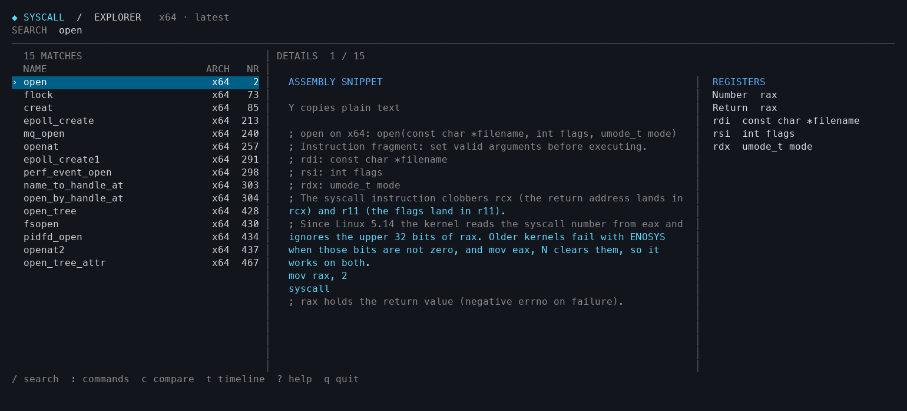

# syscall

[](https://github.com/guitmz/syscall/releases)
[](https://github.com/guitmz/syscall/actions/workflows/ci.yml)
[](https://buymeacoffee.com/guitmz)

Explore Linux system calls from your terminal. Look up numbers and signatures, compare architectures, browse kernel history or search everything in an interactive explorer.

Data comes from [api.syscall.sh](https://api.syscall.sh) and ships inside the binary, so it all works offline. New dataset, new release. You can also browse at [syscall.sh](https://syscall.sh).


## Install

```sh
brew install guitmz/tools/syscall
```

Or grab an archive for Linux or macOS from the [releases](https://github.com/guitmz/syscall/releases) page, or use Go 1.27 or newer

```sh
go install github.com/guitmz/syscall@latest
```

## Get started

```sh
syscall memfd_create
```

```
memfd_create - create an anonymous file
memfd_create(const char *uname_ptr, unsigned int flags)
needs CONFIG_MEMFD_CREATE, returns ENOSYS without it

ARCH     NR   HEX    INSN      NR REG  ARG0  ARG1  RET
x64      319  0x13f  syscall   rax     rdi   rsi   rax
x86      356  0x164  int 0x80  eax     ebx   ecx   eax
arm      385  0x181  svc #0    r7      r0    r1    r0
arm64    279  0x117  svc #0    x8      x0    x1    x0
riscv64  279  0x117  ecall     a7      a0    a1    a0

22 more arches with --arch all
```

A bare name or number is the same as `syscall get`. It shows the common arches by default. Use `--arch all` for every arch, `--arch x64,x32` for a few, or `--arch x64` for the full details of one.

```sh
syscall explore
syscall 60
syscall read --arch x64
syscall 0x3c --arch x64 --output json
syscall --arch tilepro -- -1
syscall list --arch arm64 --kernel 6.1
syscall search "file descriptor"
syscall search "family:epoll fd:true"
syscall diff 6.1 6.6
syscall history read
syscall arches
syscall conventions arm64
```

Commands that work on one arch (`list`, `search`, `history`, `snippet`, `trace`) default to your machine's arch on Linux and x64 elsewhere. By default you get the latest scanned kernel for the arch, or the latest overall when no arch is given. Use `--kernel all` to include removed calls and `syscall arches` to see what was scanned for each arch. Add `--output json` for JSON or pipe tables into `less` or `fzf`. Colors follow `--color auto|always|never` and `NO_COLOR`.

`diff` shows the common arches like a lookup does, so use `--arch all` or a list for others.

JSON plays well with `jq`

```sh
syscall read --arch all -o json | jq -r '.[] | "\(.arch) \(.nr)"'
syscall list -o json | jq -r '.[] | select(.nargs == 6) | .name'
```

TilePro has a few negative syscall numbers, so put `--` before them.

Tab completion for syscall names and arches comes with `syscall completion bash|zsh|fish`.

## Explorer

Run `syscall explore`, press `/` to search, arrows or `j` and `k` to move, `?` for every shortcut and `q` to quit.

- `c` compares arches, `t` shows kernel history, `D` diffs two releases
- `a` shows an assembly snippet and `Y` copies it
- `r` shows related calls, `1` to `9` jumps to one
- `A` and `K` change arch and kernel, `[` and `]` step through releases
- `*` saves a favorite, `f` shows favorites, `:` opens the command palette
- `m` opens the online man page, `M` a local one, `s` the kernel source
- `y` copies the signature, `C` copies a command that reopens the current view

On terminals 140 columns or wider a summary panel shows numbers per arch, history and related calls. Toggle it with `i`.

Search in the explorer and `syscall search` take the same filters, like `name:open`, `desc:socket`, `family:epoll`, `arg:fd`, `nargs:3` and `fd:true`. Emacs keys work in the explorer search box too.

Themes are `--theme dark`, `light` or `mono`.

## Snippets



```sh
syscall snippet openat --arch x64 --language asm
syscall snippet read --arch arm64 --language c
```

Assembly works for x64, x86, ia32, x32, arm64 and riscv64. C works everywhere and Go on the arches Go itself supports. Snippets use placeholder arguments, so fill them in before running anything.

## Traces

```sh
strace -f -o trace.log ./program
syscall trace --summary < trace.log
```

`trace` reads bare numbers or full `strace` and `perf trace` lines and passes anything else through untouched. Use `--only openat` to filter or `--errors` to keep failed calls.

## Dataset

History shows when a number shows up in the scanned syscall tables. Calls with a `kconfig` field can return `ENOSYS` when that option is off. See [NOTICE.md](NOTICE.md) for sources.

`make build` pulls the latest dataset, checks it against the API manifest and embeds it. Release builds do the same. Plain `go build` and `go install` use the snapshot in `dataset/`, so commit it before tagging if you want both to match. `syscall version` shows which snapshot a binary has.
